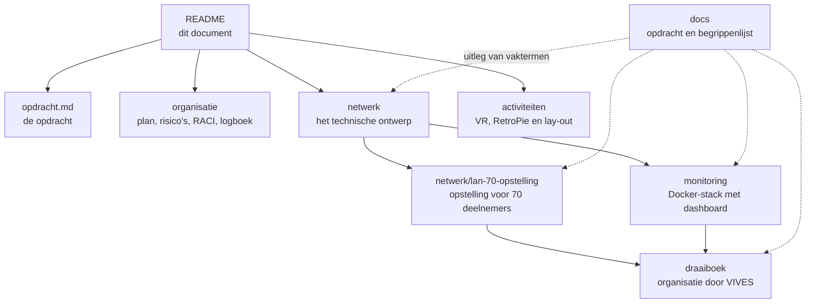

# LAN-party 26

Project 3 voor Network Experience: het ontwerpen, voorbereiden en organiseren van een veilige, inclusieve en technisch sterke LAN-party voor studenten.

## Over dit project

Dit project behandelt het volledige traject van een LAN-party, van behoefteanalyse en budgettering tot netwerkbeheer, technische ondersteuning, uitvoering en evaluatie.

De LAN-party gaat alleen door na een formele go/no-go en de nodige goedkeuringen van de betrokken diensten. Als een evenement niet wordt goedgekeurd, wordt dezelfde technische en organisatorische aanpak uitgewerkt in een tabletopoefening en een goedgekeurde dry-run.

## Waar begin ik?

Dit document is het startpunt. Elk onderwerp heeft zijn eigen map. Hieronder zie je hoe ze op elkaar aansluiten en waar je wat vindt.



| Ik wil... | Ga naar |
| --- | --- |
| Weten wat de opdracht is | [opdracht.md](docs/opdracht.md) |
| Planning, stakeholders, RACI en risico's zien | [organisatie](organisatie/projectplan.md) |
| Het netwerkontwerp in één keer begrijpen | [overzicht.md](netwerk/overzicht.md) |
| Weten hoe het netwerk van 100 naar 10 000 deelnemers meegroeit | [schaalbaar-ontwerp.md](netwerk/schaalbaar-ontwerp.md) |
| Een LAN van 70 opzetten (studentenvereniging) | [lan-70-opstelling.md](netwerk/lan-70-opstelling.md) |
| Een LAN organiseren en uitvoeren (VIVES) | [draaiboek](draaiboek/00-overzicht.md) |
| De monitoring starten, zonder voorkennis | [HANDLEIDING.md](monitoring/HANDLEIDING.md) |
| De monitoring in detail kennen | [monitoring/README.md](monitoring/README.md) |
| Een vakterm opzoeken | [begrippen.md](docs/begrippen.md) |
| Zien wat er beslist en gedaan is | [logboek](organisatie/logboek.md) |

## Stand van zaken

Stand op 16 oktober 2026. De LAN-party vindt plaats op **donderdag 22 oktober 2026, van 18:00 tot 24:00**, in **Stuvo**. De overkoepelende organisatie (inschrijving, budget en communicatie) is in handen van **IEEE student branch Brugge** (aanspreekpunt: Jonas Rollier); ons team — **Kyell en Jules** — is verantwoordelijk voor de inrichting en uitvoering in Stuvo en voor het [LAN-portaal](https://github.com/kyell182/lan-portaal) (de oorspronkelijke Python-leaderboard is deprecated; zie `leaderboard/` ter referentie). Alle vijf de go/no-go-gates sluiten **vóór 20/10**. Controleer het [logboek](organisatie/logboek.md) voor de laatste beslissingen.

| Onderdeel | Stand |
| --- | --- |
| Netwerkontwerp (modules 1 tot 3 en overzicht) | Uitgewerkt als ontwerp, nog niet afgestemd met IT |
| Schaalbaar ontwerp | Voorstel, nog niet goedgekeurd |
| LAN van 70 | Opstelling beschreven, aannames nog te bevestigen |
| Draaiboek | Eerste versie, termijnen zijn schattingen |
| Monitoring | Getest met nagebootste apparaten, nog niet met echte switches en pfSense |
| LanCache en gameservers | Nog niet gebouwd |
| Labproef met de 8 scenario's | Week 17 (Kyell); SLO-drempelwaarden worden tijdens de laboproef vastgelegd |
| Leaderboard / LAN-portaal | **Vervangen door het [LAN-portaal](https://github.com/kyell182/lan-portaal)** van Kyell (Docker, offline; toernooien + live brackets + zitplan + PWA). De oorspronkelijke Python-leaderboard (`leaderboard/`) is deprecated en blijft ter referentie. |
| Go/no-go-gates | Alle 5 sluiten vóór 20/10; Gate 1 (Concept) wordt op 16/10 met Leroy Mathieu besproken |
## Doelstellingen

- Een haalbaar en professioneel evenement uitwerken.
- Een veilig, stabiel en beheersbaar netwerk ontwerpen.
- Deelnemers en crew duidelijk informeren en ondersteunen.
- Alle technische scenario's vooraf testen in een toegelaten proefopstelling.
- Beslissingen, risico's, incidenten en resultaten aantoonbaar documenteren.

## Projectonderdelen

Het project omvat onder andere:

- projectplanning, begroting en stakeholderbeheer;
- aanvragen en goedkeuringen bij Stuvo, lokaalbeheer en IT;
- capaciteits-, stroom-, lokaal- en kabelplan;
- netwerkontwerp met beheerde switches, monitoring en configuratieback-ups;
- caching en lokale gameservices waar dit technisch en juridisch is toegelaten;
- inschrijving, privacy, gedragscode en communicatie;
- servicedesk, incidentbeheer en escalatie;
- draaiboek voor opbouw, evenement en afbraak;
- evaluatie op basis van metingen, incidenten en deelnemersfeedback.

## Go/no-go

Het evenement kan pas doorgaan wanneer de volgende gates zijn goedgekeurd:

| Gate | Vereiste goedkeuring |
| --- | --- |
| Concept | Doel, doelgroep, datumopties, capaciteit en budgeteigenaar |
| Locatie | Lokaal, openingsuren, evacuatie, toegankelijkheid, sanitair en toezicht |
| Techniek | Uplink, switches, DHCP/routing, stroomplan en toegelaten caching |
| Communicatie | Inschrijving, privacytekst, gedragscode en goedgekeurde communicatie |
| Uitvoering | Crew, support, noodnummers, rollback en cleanup |

Zonder formele goedkeuring wordt er geen verbinding gemaakt met het campusnetwerk en wordt er niet gecommuniceerd alsof het om een officieel evenement gaat.

## Technische uitgangspunten

- De door IT goedgekeurde uplink en diensten vormen de basis van het netwerkontwerp.
- Een eigen DHCP-server, router, NAT-oplossing of access point wordt niet gebruikt zonder expliciete toestemming.
- Caching, bijvoorbeeld met LANCache, wordt alleen ingezet voor toegelaten platformen en na testen van opslag, hitratio, DNS-impact en fallback.
- Deelnemersverkeer wordt niet inhoudelijk geïnspecteerd.
- Er worden geen illegale gamebestanden gedownload of gedistribueerd.
- Configuratiebestanden bevatten geen wachtwoorden, tokens of andere geheimen.

## Verplichte technische scenario's

De volgende scenario's worden getest in een toegelaten proefopstelling:

1. Een nieuwe deelnemer aansluiten en correcte connectiviteit verkrijgen.
2. Een foutief aangesloten DHCP- of routercomponent detecteren zonder het campusnetwerk te beïnvloeden.
3. Een cache hit en cache miss testen met een werkende fallback.
4. Een gameserver bereiken en de basisbelasting meten.
5. Een kabel-, switchpoort- of gameserverstoring diagnosticeren.
6. De cache uitschakelen zonder algemene internettoegang te verbreken.
7. Een monitoringalarm ontvangen en volgens het runbook behandelen.
8. De configuratie van een switch of service herstellen.

## Team en verantwoordelijkheden

Vul de namen aan en wijs voor elke taak een verantwoordelijke en eventueel een back-up aan. De verantwoordelijke bewaakt de voortgang en rapporteert over de taak in het logboek.

| Onderdeel | Verantwoordelijke | Back-up | Status | Opmerking |
| --- | --- | --- | --- | --- |
| Projectcoordinatie | Kyell | Jules | Bezig | Gates, laboproef, planning |
| GitHub en documentatie | Kyell | Jules | Bezig | Repository onderhouden |
| Budget en inkomsten | via IEEE |  | Afgevaardigd | IEEE draagt het volledige budget; wij documenteren de Stuvo- en leaderboard-posten |
| Communicatie en informatie | via IEEE |  | Afgevaardigd | IEEE stuurt de inschrijving en communicatie |
| Deelnemersregistratie | Jules |  | Bezig | Aansluiting via IEEE-inschrijving |
| Locatie, tafels en stroom | Jules | Kyell | Bezig | Stuvo; stroom- en lokaalplan vóór 20/10 |
| Netwerk en bekabeling | Kyell | Jules | Bezig | Netwerkontwerp, DHCP/routing |
| Cachingserver | Kyell |  | Bezig | Hit/miss, DNS-impact, opslag en fallback testen |
| VR / Pico 4 (Quake3Quest) | Jules |  | Bezig | Overgenomen na vertrek van Jason |
| RetroPie en minicomputer | Kyell |  | Bezig | Testen op eventhardware |
| Arduino-controller | Kyell |  | Bezig | Mogelijkheden onderzoeken |
| Games en toernooien | Jules | Kyell | Bezig | LAN-portaal volgt de toernooirondes |
| Boardgames en nevenactiviteiten | Jules |  | Afgevaardigd | Geen boardgames, enkel video games |
| Gedragscode en disclaimer | via IEEE | Jules | Afgevaardigd | Afstemmen met IEEE-communicatie |
| Support en incidenten | Kyell + Jules | crew | Bezig | Crew wordt afgestemd met IEEE |
| LAN-portaal (ex-leaderboard) | Kyell | Jules | Bezig | Vervangen door [kyell182/lan-portaal](https://github.com/kyell182/lan-portaal) |
| Stream (optioneel) | Jules |  | Nog te starten | Privacytoestemming voorzien |
| Evaluatie | Kyell + Jules |  | Nog te starten | Eind oktober |

Gebruik voor `Status` bijvoorbeeld `Nog te starten`, `Bezig`, `Geblokkeerd` of `Afgerond`.

## Logboek

Het afzonderlijke [logboek](organisatie/logboek.md) bevat belangrijke beslissingen, acties, testen, problemen en incidenten. Voeg waar mogelijk een link naar bewijs toe, zoals een document, screenshot, configuratie zonder geheimen of testresultaat.

## Planning

De evenementdatum is **donderdag 22 oktober 2026, 18:00–24:00** (vastgelegd). De tijdlijn is sterk gecomprimeerd: alle vijf de go/no-go-gates sluiten **vóór 20/10**, waarbij Gate 1 (Concept) op 16/10 met Leroy Mathieu wordt besproken. De gates worden waar mogelijk samengevoegd met de IEEE-gates van Jonas Rollier. De volledige taakchecklist met eigenaars en deadlines staat in [todo.md](organisatie/todo.md).

| Moment | Mijlpaal |
| --- | --- |
| 16 oktober | Gate 1 (Concept) bespreken met Leroy; team definitief Kyell + Jules |
| 17–18 oktober | Netwerk-, stroom-, lokaal- en veiligheidsplan bevestigen; IEEE afstemming (gates, capaciteit, bewijsstukken) |
| Week 17 | Laboproef met de 8 scenario's; SLO-drempelwaarden vastleggen (Kyell) |
| Week 16–17 | Leaderboard: oorspronkelijke Python-opzet (Jules) — vervangen door het [LAN-portaal](https://github.com/kyell182/lan-portaal) van Kyell |
| 20 oktober | Alle 5 gates gesloten en geregistreerd in het logboek |
| 21 oktober | Opbouw in Stuvo, dry-run met meerdere clients, formele go/no-go (Gate 5) |
| **22 oktober** | Uitvoering (18:00–24:00), incidentregistratie en cleanup |
| Eind oktober | Evaluatie en overdraagbaar draaiboek |

## Succesmetingen

Het project wordt geëvalueerd aan de hand van:

- een opbouw en afbraak binnen het afgesproken tijdsvenster;
- het uitblijven van vermijdbare veiligheids- en netwerkincidenten;
- de afgesproken deelnemerscapaciteit en opkomst;
- vooraf bepaalde grenzen voor mediane latency en packet loss;
- aantoonbare cachewinst zonder afhankelijkheid van de cache;
- de gemiddelde oplostijd van supportvragen;
- deelnemersfeedback en correcte verwijdering van gegevens na de bewaartermijn.

## Repositorystructuur

```text
.
├── README.md                          Projectoverzicht (dit document)
├── CLAUDE.md                          Richtlijnen voor Claude Code in deze repository
├── docs/                              Brondocumenten
│   ├── opdracht.md                    Volledige opdrachtomschrijving en vereisten
│   └── begrippen.md                   Begrippenlijst voor alle documenten
├── organisatie/                       Plan, risico's en afspraken
│   ├── projectplan.md                 Namen, datums, locaties
│   ├── leaderboard.md                 Hoofdtaak: live scoreboard, scope en privacy
│   ├── conceptnota.md                 Basis voor Gate 1: Concept akkoord
│   ├── stakeholderregister.md         Betrokkenen met belang, invloed en communicatie
│   ├── raci-matrix.md                 Beslissen, uitvoeren, raadplegen en informeren per taak
│   ├── risicoanalyse.md               Risicobepaling en opvolging van go/no-go-beslissingen
│   ├── bevraging-microsoft-forms.md   Gearchiveerd — inschrijving verloopt via IEEE
│   ├── logboek.md                     Beslissingen, acties, testen en incidenten
│   └── todo.md                        Taakchecklist per fase (vóór event, eventdag, nadien)
├── draaiboek/                         Herbruikbaar draaiboek voor VIVES
│   ├── 00-overzicht.md                Rollen, gates en tijdlijn
│   ├── 01-voorbereiding.md
│   ├── 02-opbouw.md
│   ├── 03-evenement.md
│   ├── 04-afbraak-en-evaluatie.md
│   └── 05-bijlagen.md                 Sjablonen
├── netwerk/                           Het technische ontwerp
│   ├── architectuur.md                Module 1: netwerk, VLANs en stroom
│   ├── monitoring-stack.md            Module 2: monitoring
│   ├── server-services.md             Module 3: LanCache, switchbeveiliging en QoS
│   ├── overzicht.md                   Samenvatting van module 1 tot 3
│   ├── schaalbaar-ontwerp.md          Meegroeien van 100 tot 10 000 deelnemers
│   └── lan-70-opstelling.md           Opstelling voor 70 deelnemers (studentenvereniging)
├── monitoring/                        Docker-stack voor de monitoring
│   ├── HANDLEIDING.md                 Stap voor stap, zonder voorkennis
│   ├── README.md                      Dashboard, alarmen en naslag
│   ├── docker-compose.yml
│   ├── .env.example
│   ├── telegraf/                      Configuratie van de verzamelaar
│   ├── grafana/                       Dashboard, alarmen en datasource
│   └── lan-70/                        Ingevulde variant voor de LAN van 70
└── activiteiten/                      Bijdragen aan de LAN-party
    ├── concepten.md                   Eerste ideeën en taakverdeling
    ├── layout-lan-party.pdf           Indeling Stuvo met netwerkkasten, kranen en stroompunten
    ├── vr-pico4/
    │   └── vr-setup-concept.md        VR met Pico 4 / Quake3Quest
    └── retropie/
        ├── installatie-retropie.md    Arcadekast op minipc (credentials.md gitignored)
        └── assets/                    Afbeeldingen voor de installatiehandleiding
```

Projectdocumenten en bewijsstukken worden toegevoegd zodra ze zijn uitgewerkt en goedgekeurd. Denk hierbij aan de RACI-matrix, begroting, risicoanalyse, netwerkdiagram, IP- en bandbreedteplan, cachebenchmark, privacy- en communicatieplan, gedragscode, draaiboek, servicedeskprocedure, incidentlog en evaluatierapport.
## Scope

### Binnen scope

- Organisatie en technische voorbereiding van de LAN-party.
- Netwerk-, stroom-, lokaal- en veiligheidsplanning.
- Testen, monitoring, support en incidentbeheer.
- Communicatie, inschrijving en evaluatie.

### Buiten scope

- Aansluiten of configureren vóór goedkeuring.
- Niet-goedgekeurde draadloze access points, DHCP, NAT of publieke gameservers.
- Opslag van betalings- of gezondheidsgegevens in deze repository.
- Alcohol- of cateringafspraken buiten het beleid van de campus en Stuvo.

## Referentie

De volledige opdrachtomschrijving staat in [opdracht.md](docs/opdracht.md).
