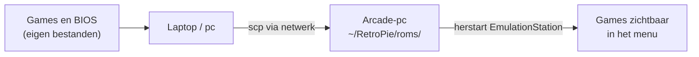
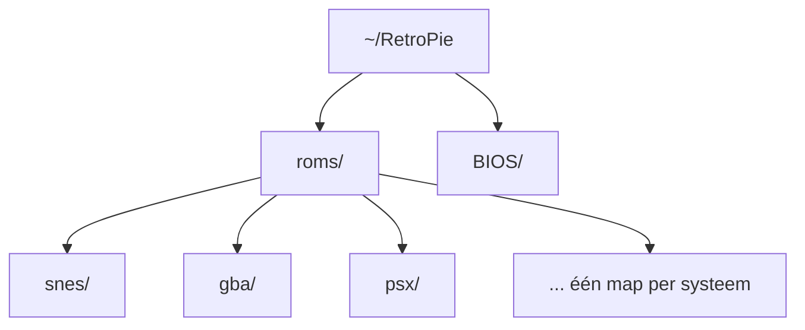
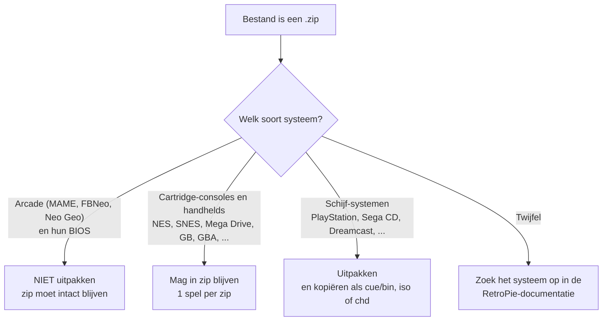
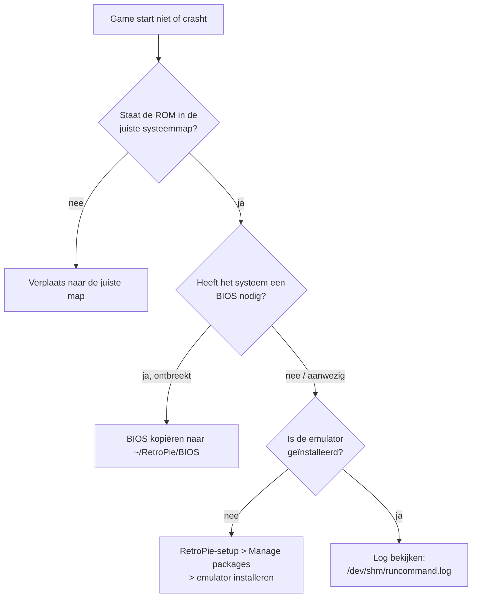

# Bestanden kopiëren naar de arcadekast

Deze handleiding legt uit hoe je bestanden via `scp` op de arcade-pc zet en er weer vanaf haalt: games, BIOS-bestanden en reservekopieën van de configuratie.

> Waar je ROM's en BIOS-bestanden vandaan haalt en of je ze mag gebruiken, is de verantwoordelijkheid van de gebruiker. Het project levert en documenteert geen ROM's of BIOS-bestanden.

## Overzicht



## Voorbereiding

1. Arcade-pc en laptop zitten op hetzelfde netwerk.
2. SSH staat aan op de arcade-pc. Controleer dit met `sudo systemctl status ssh`. Staat het uit, installeer het dan met `sudo apt install openssh-server`.
3. Gebruikersnaam en hostnaam of IP-adres van de arcade-pc staan in [credentials.md](credentials.md). Hieronder staan ze als `<gebruiker>` en `<host>`.

Test de verbinding eerst:

```bash
ssh <gebruiker>@<host>
```

## Mappenstructuur op de arcade-pc



- Elke ROM staat in de map van zijn systeem, bijvoorbeeld `~/RetroPie/roms/snes/`.
- BIOS-bestanden staan in `~/RetroPie/BIOS/`.

Gebruik de mapnamen van RetroPie. Een systeem met een afwijkende mapnaam verschijnt niet in het menu.

## Stap voor stap

1. Zet de bestanden op de laptop in één map per systeem, bijvoorbeeld `roms/`.

2. Kopieer één systeem als test:

    ```bash
    scp -r roms/snes <gebruiker>@<host>:~/RetroPie/roms/
    ```

3. Kopieer daarna de rest. `-r` kopieert mappen, `-p` bewaart de datums:

    ```bash
    scp -rp roms/* <gebruiker>@<host>:~/RetroPie/roms/
    ```

4. Kopieer BIOS-bestanden op dezelfde manier:

    ```bash
    scp -r bios/* <gebruiker>@<host>:~/RetroPie/BIOS/
    ```

5. Controleer de rechten op de arcade-pc. Bestanden die als een andere gebruiker zijn aangemaakt, kan EmulationStation soms niet lezen:

    ```bash
    sudo chown -R $USER:$USER ~/RetroPie/roms ~/RetroPie/BIOS
    ```

6. Herstart EmulationStation: druk op Start, kies Quit en daarna Restart EmulationStation. De nieuwe games staan nu in het menu.

Een grote kopie kun je beter hervatbaar maken met `rsync`, als dat op beide kanten beschikbaar is:

```bash
rsync -avP roms/ <gebruiker>@<host>:~/RetroPie/roms/
```

## Zip: laten staan of uitpakken?



Vuistregels:

- **Arcade (MAME, FBNeo, Neo Geo) en de BIOS-bestanden daarvan, zoals `neogeo.zip`:** nooit uitpakken. De emulator zoekt het zipbestand zelf en leest de inhoud ervan. Een uitgepakte map werkt niet.
- **Cartridge-systemen (NES, SNES, Mega Drive, Master System, Game Boy, GBA, ...):** meestal mag de zip blijven zoals hij is, zolang er één spel in zit en het spelbestand direct in de zip staat (niet in een submap). Zit er meer dan één spel in een zip, pak hem dan uit.
- **Schijf-systemen (PlayStation, Sega CD, Dreamcast, PC Engine CD, ...):** pak de zip uit. Deze systemen hebben `.cue` met `.bin`, `.iso`, `.chd` of `.m3u` nodig, en alle bijhorende bestanden moeten samen in dezelfde map staan.
- **Twijfel of werkt het niet?** Per systeem staat in de RetroPie-documentatie welke extensies zijn toegestaan. Pak dan de zip uit en probeer opnieuw.

Uitpakken op de arcade-pc:

```bash
sudo apt install unzip
unzip spel.zip -d ~/RetroPie/roms/<systeem>/
```

## Een emulator werkt niet?



Dit is ook de lijst om de emulators af te gaan die nu nog niet correct werken. Noteer per systeem het resultaat in de [README](README.md).

