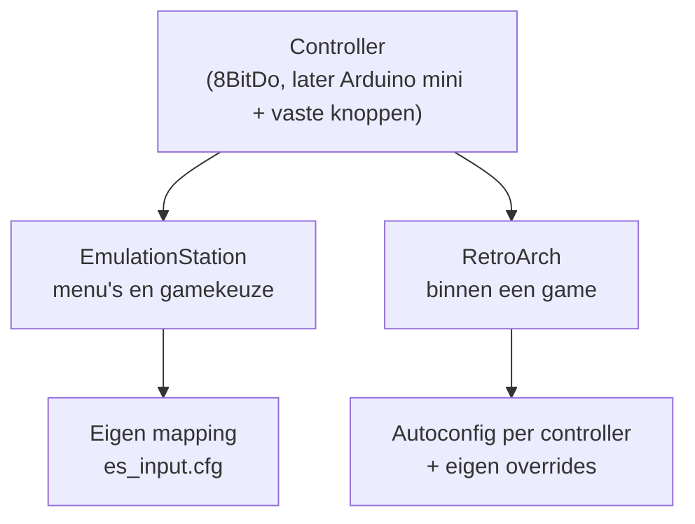
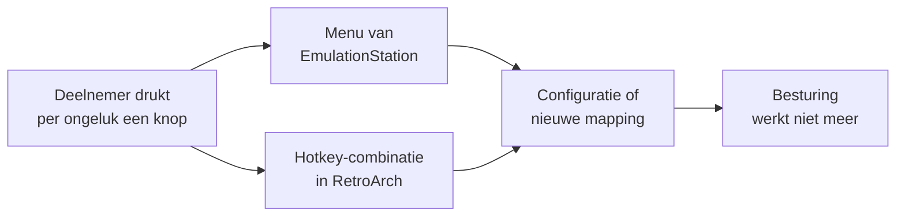

# Controllers en menu's op de arcadekast

Deze handleiding beschrijft hoe de controllers werken en hoe je voorkomt dat deelnemers per ongeluk de configuratie wijzigen.

## Hoe de besturing is opgebouwd



Er zijn dus twee lagen met een eigen mapping: het menu en de game. Een wijziging in de ene laag verandert de andere niet.

## Een controller koppelen en mappen

1. Sluit de controller aan en laat hem in het menu van EmulationStation een knop indrukken.
2. Staat de controller er nog niet in, houd dan een knop ingedrukt om het inputscherm te openen en volg de stappen.
3. Voor de games gebruik je RetroPie-setup: Configuration / tools, daarna het onderdeel voor controllers.

De 8BitDo-controllers werken, maar elke andere controller kan op dezelfde manier worden gemapt.

## Het probleem: deelnemers belanden in de configuratie

Op de LAN-party kwamen deelnemers soms in het configuratiemenu terecht, waardoor de mapping van de besturing soms verdween. Er zijn twee plaatsen waar dat gebeurt:



### Maatregel 1: kioskmodus in EmulationStation

EmulationStation heeft een UI-modus die het menu verbergt:

1. Start, daarna Other settings, daarna UI mode.
2. Kies Kiosk. Het menu toont dan geen instellingen meer.
3. Terug naar de volledige modus kan met de ontgrendelcode die EmulationStation toont. Noteer die code in [credentials.md](credentials.md), niet in de repository.

### Maatregel 2: hotkey in RetroArch beperken

In een game opent een hotkey-combinatie (standaard de Select-knop samen met een andere knop) het RetroArch-menu. Dit pas je aan in `/opt/retropie/configs/all/retroarch.cfg`. Controleer de juiste optienamen in de RetroPie-documentatie voor jouw versie en test na elke wijziging.

> Test beide maatregelen met een gewone controller voor je de kast opnieuw gebruikt, en zorg dat jij zelf nog in de configuratie kunt via SSH.

### Maatregel 3: reservekopie van de configuratie

Maak een kopie van de werkende configuratie, zodat je snel kunt herstellen wanneer de mapping toch verdwijnt:

```bash
mkdir -p ~/configbackup
cp ~/.emulationstation/es_input.cfg ~/configbackup/
cp -r /opt/retropie/configs/all ~/configbackup/
```

Herstellen gaat omgekeerd met `cp`. Haal een reservekopie ook naar je laptop met `scp`, zoals beschreven in [bestanden-kopieren.md](bestanden-kopieren.md).

## Nog te doen

- Vaste knoppen van de kast aansluiten.
- De Arduino mini programmeren zodat de kast zich als controller aanmeldt. Die handleiding komt in een apart bestand zodra de knoppen er zijn.
