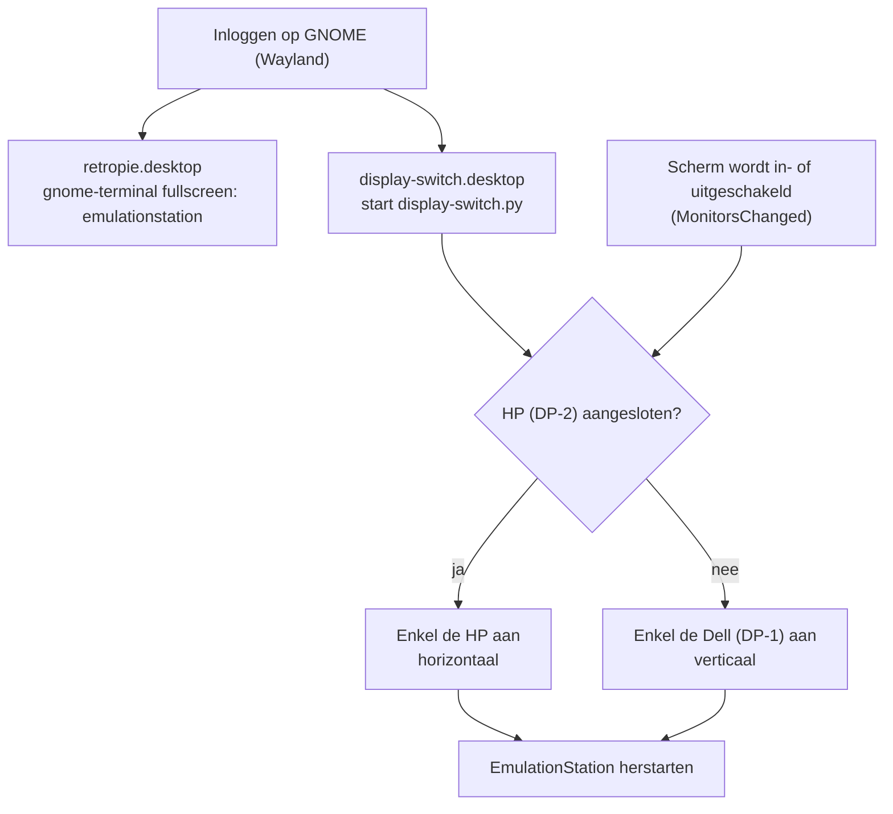
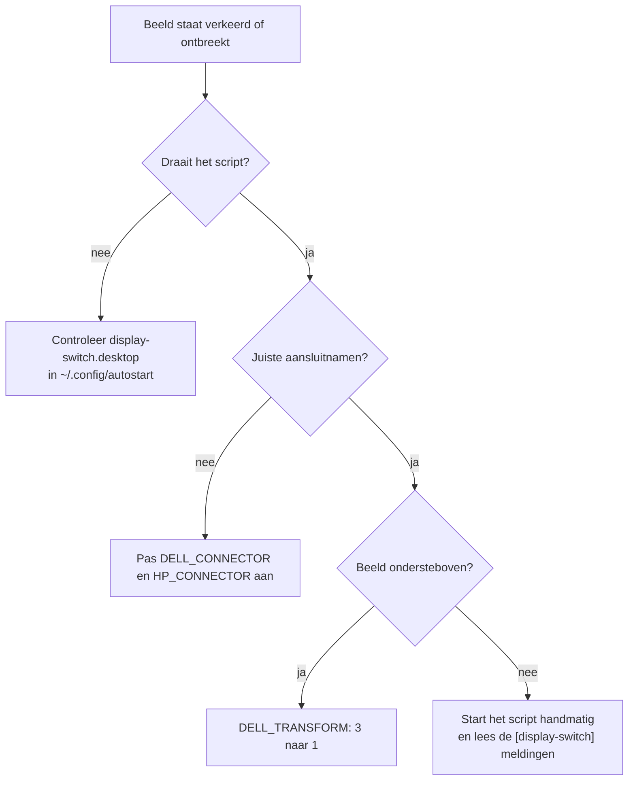

# Scherm en autostart

Hoe de arcadekast bij het inloggen automatisch start en hoe hij tussen twee schermen schakelt. De bestanden uit deze handleiding staan als kopie in [scripts/](scripts/). De bron staat op de arcade-pc.

## Overzicht



## Onderdelen

| Bestand op de arcade-pc | Kopie in de repo | Doet |
| --- | --- | --- |
| `~/.config/autostart/retropie.desktop` | [scripts/retropie.desktop](scripts/retropie.desktop) | Start EmulationStation schermvullend in een terminal bij het inloggen |
| `~/.config/autostart/display-switch.desktop` | [scripts/display-switch.desktop](scripts/display-switch.desktop) | Start het schermscript bij het inloggen |
| `~/.config/display-switch.py` | [scripts/display-switch.py](scripts/display-switch.py) | Kiest het juiste scherm en de rotatie, en blijft draaien om wijzigingen op te vangen |

## Autostart van EmulationStation

`retropie.desktop` start bij het inloggen:

```text
gnome-terminal --full-screen --hide-menubar -e emulationstation
```

Dit gebruikt de autostart van GNOME. Een ander mechanisme, zoals `autostart.sh` van RetroPie, is niet nodig. Het bestand `/opt/retropie/configs/all/autostart.sh` is leeg of bestaat niet.

## Schermscript

De kast kan met twee schermen werken: een Dell die verticaal staat (`DP-1`) en een HP die horizontaal staat (`DP-2`).

- Is de HP aangesloten en aan, dan toont alleen de HP het beeld, horizontaal.
- Is de HP los of uit, dan toont alleen de Dell het beeld, verticaal.

`xrandr` werkt niet op Wayland. Het script praat daarom rechtstreeks met Mutter, de schermbeheerder van GNOME, via D-Bus. Het blijft draaien en reageert op het signaal `MonitorsChanged`, zodat omschakelen ook werkt terwijl de kast aanstaat. Bij elke wijziging herstart het ook EmulationStation, zodat dat zich aanpast aan de nieuwe afmetingen.

### Instellingen aanpassen

Bovenaan in `display-switch.py` staan de instellingen:

| Instelling | Betekenis |
| --- | --- |
| `DELL_CONNECTOR`, `HP_CONNECTOR` | Naam van de aansluiting van elk scherm (`DP-1`, `DP-2`) |
| `DELL_TRANSFORM` | Rotatie van de Dell. Staat het beeld ondersteboven, verander dan `3` naar `1` |
| `HP_TRANSFORM` | Rotatie van de HP (`0` = normaal) |
| `PREFERRED_RESOLUTION` | Gewenste resolutie, nu 1920 × 1080 |

Na een wijziging log je uit en weer in, of herstart je de pc.

### Een scherm werkt niet?



Handmatig starten om de meldingen te zien, in een terminal op de kast:

```bash
python3 ~/.config/display-switch.py
```

## Nog te doen

- De oriëntatie van de gebruikersinterface bekijken. Staat EmulationStation goed gericht op de Dell (verticaal) en de HP (horizontaal)?
- De bronbestanden in [scripts/](scripts/) up-to-date houden wanneer je het script op de pc aanpast.
